# MySQL browser FIDO gateway

Use a security key in a web browser to register and sign in to MySQL with
**password + WebAuthn two-factor authentication**. The key stays on the user's
computer; the Python gateway connects to MySQL. Remote users need only access
to the HTTPS website, even when the database is on a private network.

This personal prototype/tutorial includes a reusable Python wheel, Flask
helpers, editable login/registration templates, browser JavaScript, and an app
generator. MySQL verifies authentication and enforces the user's database
grants. There is no separate application passkey database, and the MySQL
product plugins remain unchanged.

## Libraries and ways to use them

Version **0.3.1** is one wheel, `mysql-browser-fido-gateway`, with three interfaces:

| What you want to build | Library interface | Usage |
| --- | --- | --- |
| A demo for creating users, registering keys, and logging in | `mysql_fido_gateway.flask_util` | `create_demo_app()` supplies the three-in-one demo; `create_action_app()` supplies individual tutorial pages. Each action closes its connection. |
| A Flask application with protected pages and SQL | `mysql_fido_gateway.flask_login` | `create_gateway_app()` supplies login, registration, and per-user sessions. Use `auth.getConnection()` for SQL on the authenticated connection. |
| A custom web framework or browser transport | `Gateway` from `mysql_fido_gateway` | Implement the browser exchange callback for `register()` and `connect()`. Your application owns the returned login connection. |

The Flask interfaces include Jinja templates and JavaScript. `newapp` generates
an application folder where you can edit the forms, banner, colors, and business
routes. SQL supports bound parameters, multiple rows, and transactions under
each user's MySQL grants; see the [library and SQL guide](docs/flask-wheel.md).

The adapter uses **MySQL Connector/Python 26.10.0**, pinned because it depends on
private connector APIs. The wheel does not bundle a MySQL server or security
key. The gateway needs neither a native `mysql` executable nor an attached key.

## Deployment models

### Local development

Run the browser, HTTPS proxy, Flask app, and test database on one computer.
Caddy serves `https://localhost`; the application listens only on loopback.
MySQL host, port, and TLS settings are supplied explicitly.



### Remote users and private MySQL

Users visit the deployed HTTPS site and use their own keys. Only the application
server needs network access to MySQL. The gateway receives the MySQL password
over HTTPS; the security-key PIN and private key stay with the browser/device.



Both models require the browser origin `https://RP_ID` on port **443**, matching
MySQL's configured WebAuthn RP ID. Use one Python process: pending ceremonies
and authenticated sessions are held in memory. See [deployment settings](docs/deployment.md)
for ports, TLS, and remote setup.
Editable diagram sources: [local](docs/diagrams/deployment-local.mmd) ·
[remote](docs/diagrams/deployment-remote.mmd).

## Get started without cloning

The operator needs Python 3.10+, a prepared MySQL server/account with WebAuthn
factor 2, and a compatible external FIDO2 key. The local launcher also needs
Caddy and a trusted local HTTPS certificate.

On macOS/Linux:

```bash
python3 -m venv gateway-tools
gateway-tools/bin/python -m pip install 'mysql-browser-fido-gateway[flask] @ https://raw.githubusercontent.com/ivanxma/mysql_fido_gateway_demo/main/downloads/0.3.1/mysql_browser_fido_gateway-0.3.1-py3-none-any.whl'
gateway-tools/bin/python -m mysql_fido_gateway newapp
```

The generator asks for the application name, MySQL host/port, and TLS choice.
Open the generated folder and run `python3 start.py`, then use
`https://localhost/login`. Choose **Register a passkey**, enroll the provisioned
MySQL account, and sign in to run the sample SQL.

See [Getting started](GETTING_STARTED.md) for prerequisites, Windows commands,
the [downloadable starter ZIP](downloads/README.md), and personalization.
To run the three-in-one demo, follow the
[reference application setup](docs/user-manual.md#install-and-start-the-local-reference-application).

## Browser modes and tested scope

| Registration mode | Intended use | Evidence for this release |
| --- | --- | --- |
| **Browser only** (`browser`, default) | Browser registration and login | User-confirmed Chrome login and SQL in normal and Incognito windows; wrong-password and cancelled-key attempts rejected. Native MySQL client compatibility is not established. |
| **Browser + MySQL client** (`shared`) | Browser enrollment followed by either login method | Browser registration, browser login, and stock MySQL client login passed with the tested Firefox direct security-key backend. Chrome shared enrollment is incompatible with the tested server verifier. |

The three-in-one demo has a registration-mode switch. Generated apps use
`REGISTRATION_MODE` in `.env`. Changing modes affects new enrollment; it does
not convert an existing credential. See the
[Firefox setup and mode differences](docs/user-manual.md#shared-browser-and-native-client-enrollment).

Registration requests PIN/user verification. Login requests touch without PIN;
the browser or key policy can still require verification. General platform or
cloud passkeys are outside the supported profile. These results cover the
recorded MySQL 26.10.0-commercial/YubiKey setups, not every browser or key.
This is an experimental prototype, not a production authentication service.
See [limitations](docs/user-manual.md#limitations) and the
[validation evidence](VALIDATION.md).

## Documentation and demos

| Read or watch | Covers |
| --- | --- |
| [Documentation index](docs/README.md) | User manual, API, configuration, and tutorials |
| [Flask library and SQL](docs/flask-wheel.md) | `getConnection()`, parameters, transactions, and migration |
| [Create user](docs/create-user-tutorial.md) · [Register key](docs/registration-tutorial.md) · [Login and main page](docs/login-main-tutorial.md) | Separate application examples |
| [Getting-started video](demo/mysql-fido-newapp-getting-started.mp4) — 1:58 | App generation, screens, and banner/color changes |
| [Authentication demo](demo/mysql-gateway-demo.mp4) — 1:48 | Create user, register, and log in |

The videos use a simulated database; the authentication video's security-key
prompts are illustrative. Physical-key test results are recorded separately in
[VALIDATION.md](VALIDATION.md).

## License

Independent personal project by ivanxma, licensed under [MIT](LICENSE).
It is not an Oracle product, endorsement, support offering, or warranty.
See [DISCLAIMER.md](DISCLAIMER.md) and the separate
[third-party license terms](THIRD_PARTY_LICENSES.md).
