# Deployment models

The same library supports local development and remote browser users. The
browser handles the user's security key; the gateway connects to MySQL and
relays the authentication proof. MySQL verifies both factors and enforces SQL
grants. No security key or native `mysql` executable is needed on the gateway.

## Local development

[Diagram source](diagrams/deployment-local.mmd)

The local launcher serves `https://localhost` through Caddy and forwards to
Flask over loopback HTTP. Trust Caddy's local CA before registering a key.
MySQL's RP ID must be `localhost`; its connection timeout should be at least
180 seconds so the browser ceremony can finish.

| Connection | Address or port |
| --- | --- |
| Browser → Caddy | `https://localhost`, port 443 |
| Caddy → reference demo | `127.0.0.1:5001` |
| Caddy → generated starter | `127.0.0.1:5003` |
| Gateway → MySQL | Operator-supplied host and port; no default |

The demo and starter are alternative applications. Their local launchers use
the same HTTPS origin; run the intended application behind that origin.
The backend HTTP port is not a supported WebAuthn browser origin.

Use a CA certificate and verified database TLS. The explicit loopback-only
development exception is also available, but does not establish successful
fresh-account password authentication without TLS; see the
[validation record](../VALIDATION.md). Start with
[Getting started](../GETTING_STARTED.md).

## Remote users and private MySQL

[Diagram source](diagrams/deployment-remote.mmd)

The operator installs the application on a host that can reach MySQL and
places an HTTPS proxy in front of it. Users visit the public site and enroll
their own keys through the browser. Their computers need no database access
or native MySQL client.

Configure `RP_ID` as the website hostname, for example `fido.example.com`, and
`BROWSER_ORIGIN=https://fido.example.com` on port 443. MySQL's WebAuthn RP ID
must match. Keep this hostname stable: changing it can invalidate existing
registrations. MySQL account host rules match the gateway's source address
as seen by MySQL, not the user's browser address.

Set the actual `DB_HOST`, `DB_PORT`, and `DB_SSL_CA`. Remote database connections
require certificate and hostname verification. Browser HTTPS and database TLS
are separate connections. The gateway receives the MySQL password to perform
factor 1; the key's PIN and private key stay with the browser/device.

Use one Python process because ceremonies and retained login connections are
in memory. Restarting ends pending ceremonies and application sessions; MySQL
and the security key retain the enrolled credential. This prototype requires
additional operational controls before production use; see
[limitations](user-manual.md#limitations).

See [remote setup](user-manual.md#use-a-remote-browser-or-database) and the
[configuration reference](configuration.md) for settings. Registration and
login message sequences are separate from these deployment diagrams in the
[user manual](user-manual.md#how-it-works).
