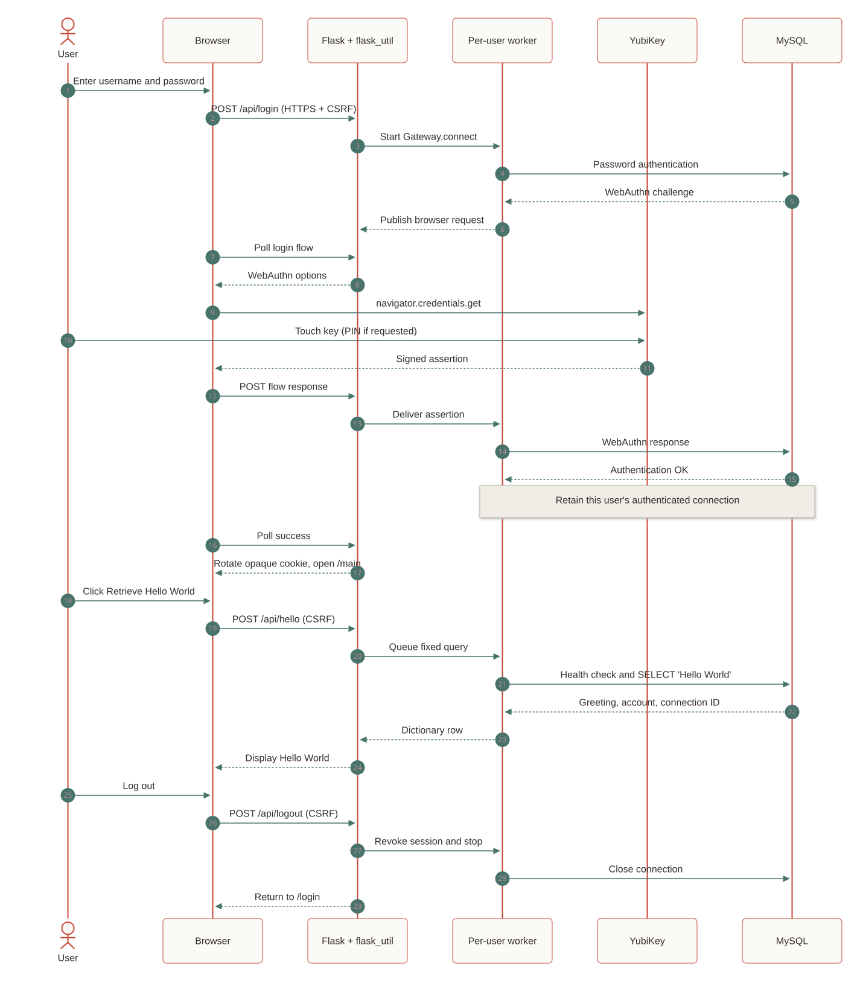

# Tutorial 3: YubiKey login, main page, and Hello World

Build a separate Flask application with a login page requiring a MySQL password and registered YubiKey. After MySQL accepts both factors, the browser opens a protected main page. Clicking **Retrieve Hello World** runs SQL on that user's authenticated connection.

For a download-first route, start with [the no-clone guide](../GETTING_STARTED.md) and `newapp`. The source-based runnable starter is in [examples/login_app](examples/login_app/app.py). Its `app.py` contains only application creation, the protected main page, and the Hello World action. The wheel's `mysql_fido_gateway.flask_login` module supplies Flask configuration, WebAuthn transport, sessions, and connection cleanup, including linked sign-in and passkey registration pages. The starter contains editable `templates/auth/` pages, application branding CSS, its main page, and business routes; editable browser scripts under `static/auth/` start from the library’s default implementations. See [the wheel and SQL guide](flask-wheel.md) for reusable application integration.

## The application you will build

| Page | What the user sees | Next action |
| --- | --- | --- |
| `/login` | One login form: MySQL username, password, and **Sign in with security key** | MySQL verifies the password and the key, then the browser opens `/main` |
| `/register` | Existing account credentials and **Register security-key passkey** | Browser handles key PIN/touch; after MySQL accepts enrollment, return to sign in |
| `/main` | A protected main page with **Retrieve Hello World**, a result area, and **Log out** | Clicking the greeting button retrieves `Hello World` from MySQL |

These are separate pages. The MySQL account must be provisioned first. Users with an enrolled key sign in directly; users with an unregistered WebAuthn factor follow **Register a passkey** on the login page.

**Use the starter in `docs/examples/login_app/`.** The repository-root `app.py` and `start.sh` launch the three-column administration demo. The supplementary `docs/examples/new_app/` starter also has a different interface. Follow the copy and run commands below to build this application in `../gateway_login_app`.

## Step 1 Prepare an enrolled account

Complete [Tutorial 1: Create a MySQL user](create-user-tutorial.md) first. You can enroll its key through this application’s **Register a passkey** link, or use the separate [registration tutorial](registration-tutorial.md). Use the same account, password, key, database, and RP ID across all three tutorials.

You need:

- Python 3.12+, the pinned Connector/Python version installed by this repository, and MySQL with the supported WebAuthn plugin and password + WebAuthn factor 2 account.
- A supported FIDO2 security key, such as a YubiKey. An already enrolled key can sign in; an unregistered account can enroll through `/register`. See the [full requirements](user-manual.md#requirements).
- MySQL's RP ID and application `RP_ID` both set to `localhost`, with `connect_timeout` at least 180 seconds (preserve higher values).
- A WebAuthn browser opening trusted `https://localhost` on port 443. The current gateway validates that exact HTTPS origin. Other hostnames and ports are different origins. A different RP ID requires corresponding server configuration and registration.

Choose and explicitly configure your MySQL host, port, and TLS mode; none is assumed. The Flask backend uses `127.0.0.1:5003`. `demo_tutorial` is an illustrative provisioned account name, not an implicit login. It contains sign-in and key registration pages; account provisioning stays with the administrator.

## Step 2 Create a new project

From the gateway repository root:

```bash
export GATEWAY_SOURCE="$PWD"
mkdir ../gateway_login_app
cd ../gateway_login_app
python3 -m venv .venv
source .venv/bin/activate
python "${GATEWAY_SOURCE}/scripts/build_release.py"
python -m pip install "${GATEWAY_SOURCE}/dist/mysql_browser_fido_gateway-0.3.1-py3-none-any.whl[flask]"
python -c "from mysql_fido_gateway.flask_login import create_gateway_app; print('Flask FIDO library import OK')"
cp "${GATEWAY_SOURCE}/docs/examples/login_app/app.py" "${GATEWAY_SOURCE}/docs/examples/login_app/config.example.env" "${GATEWAY_SOURCE}/docs/examples/login_app/Caddyfile.local" "${GATEWAY_SOURCE}/docs/examples/login_app/.gitignore" .
cp -R "${GATEWAY_SOURCE}/docs/examples/login_app/templates" "${GATEWAY_SOURCE}/docs/examples/login_app/static" .
```

Choose a different empty project directory if that name already exists. The first pip command builds the library wheel; skip it if you already have the reviewed 0.3.1 wheel. The second installs that wheel with its Flask dependency. This is a regular installation: changes in the library checkout take effect only after rebuilding and reinstalling. The sample application's files remain editable in your project.

```text
gateway_login_app/
  app.py
  .gitignore
  templates/
    auth/
      base.html
      login.html
      register.html
    main.html
  static/
    auth.css
    auth/
      common.js
      webauthn.js
      login.js
      register.js
    main.js
  config.example.env
  Caddyfile.local
```

## Step 3 Set the environment

```bash
cp config.example.env .env
set -a
source .env
set +a
export FLASK_SECRET_KEY="$(python -c 'import secrets; print(secrets.token_hex(32))')"
```

Edit `.env` to match your database before sourcing it. Never put end-user or root passwords in this file. The user types their password on the login page.

| Variable | Default / purpose |
| --- | --- |
| `FLASK_SECRET_KEY` | Required; signs the opaque session cookie. Keep private and stable for the process |
| `BROWSER_ORIGIN` | `https://localhost`; must equal `https://` plus `RP_ID`, without a custom port |
| `RP_ID` | `localhost`; must match the server's WebAuthn RP ID and the registered credential |
| `DB_HOST` / `DB_PORT` | Required explicit MySQL target; no default host or port |
| `DB_SSL_CA` | Optional CA path; when set enables certificate and hostname verification |
| `ALLOW_LOOPBACK_DB_PLAINTEXT` | Only `1` permits the development exception for exact loopback host strings; enable it explicitly only for your chosen loopback development target |
| `SESSION_TTL_SECONDS` | `300`; absolute authenticated lifetime in seconds, allowed range 1–3600 |

For a remote MySQL server, use a certificate-matching database hostname and `DB_SSL_CA`, and remove the loopback exception. Browser HTTPS and database TLS are separate connections.

## Step 4 Start Flask

In Terminal 1, make sure you are in the **new project directory** created in step 2, with its virtual environment active and the step 3 environment exported:

```bash
pwd
python app.py
```

The printed directory should end in `gateway_login_app`. Keep this terminal open. Flask must report `127.0.0.1:5003`. A listener on port 5001 belongs to the original demo; port 5002 belongs to the registration tutorial, and port 5004 to the create-user tutorial. The application reads exported environment variables, and does not load `.env` by itself.

## Step 5 Point local HTTPS at this application

In Terminal 2, enter the same **new project directory**. When it is beside the gateway checkout as in step 2:

```bash
cd /path/to/gateway_login_app
cat Caddyfile.local
```

Replace `/path/to/gateway_login_app` with its actual path from Terminal 1. The proxy configuration must contain `reverse_proxy 127.0.0.1:5003`. If Caddy is already serving the earlier tutorial or reference app, reload this project's configuration:

```bash
caddy reload --config Caddyfile.local --adapter caddyfile
```

Otherwise start it in the foreground:

```bash
caddy run --config Caddyfile.local --adapter caddyfile
```

Use the existing trusted local Caddy installation from the [HTTPS setup reference](new-application.md#step-8-point-local-https-at-the-new-application). Local certificate trust and permission to bind port 443 must already be configured. This changes the local `https://localhost` target to backend 5003; stop the old Flask process if it is no longer needed. See [Caddy's command documentation](https://caddyserver.com/docs/command-line).

Open **https://localhost**. You should see **Sign in with your passkey**. Opening the raw backend redirects to the configured HTTPS origin.

**Checkpoint:** the browser shows one username/password form and one sign-in button. If it shows three columns, HTTPS is still targeting the original demo. Check the proxy configuration above and reload it from `gateway_login_app`, then refresh the browser. Running the new Flask process alone does not change an existing proxy's target.

## Register a passkey from the login page

For a provisioned account whose WebAuthn factor is not yet enrolled:

1. On `/login`, choose **Register a passkey**.
2. Enter the existing MySQL username and password.
3. Connect a compatible FIDO2 security key and choose **Register security-key passkey**.
4. Complete the browser’s security-key PIN verification and touch prompt.
5. Wait for MySQL to accept registration, then choose **Continue to sign in**.

Registration does not create a database account or sign the user in. The PIN stays in the browser/key interaction. The gateway still requires the supported packed ES256/x5c attestation; platform/cloud passkeys are not broadly supported by this prototype.

## Step 6 Sign in using the key

1. Insert your registered YubiKey.
2. Enter the enrolled MySQL username and its password.
3. Click **Sign in with security key**.
4. Follow the browser's prompt and touch the key.
5. Wait for MySQL to verify the assertion. Success opens `/main`.

The gateway requests touch-only login (`userVerification: discouraged`), although browser/key policy may still request a PIN. A PIN is entered in the browser/authenticator prompt and never sent to Python. Wrong passwords, cancelled prompts, and rejected signatures leave the main page inaccessible.

## Step 7 Retrieve Hello World

Click **Retrieve Hello World** on the main page. The route executes:

```sql
SELECT 'Hello World' AS message,
       CURRENT_USER() AS mysql_account,
       CONNECTION_ID() AS connection_id
```

The response shows `Hello World`, your effective MySQL account, and the connection ID. Click again: the same authenticated connection is reused, so this action does not start a second key ceremony. The server runs `SELECT 1 AS alive` before using the retained connection.

The application binds the greeting as a parameter, using `cursor.execute(HELLO_SQL, ('Hello World',))`; MySQL returns the result. Sending a request body containing SQL does not change the query; `/api/hello` always uses the SQL defined in `app.py`.

The `getConnection()` context automatically commits on success, rolls back on an exception, and closes its cursors. It retains the authenticated connection for subsequent requests and releases it on logout or expiry. Your routes can use the same pattern for table reads and writes using that account's grants.

## Step 8 Log out and check protection

Click **Log out**. The browser returns to `/login`, server access is revoked immediately, and the worker closes its connection. Directly visiting `/main` now returns to login. The same happens after the configured absolute session lifetime or a failed database health check.

Restarting Flask loses all in-memory sessions. A remaining signed cookie alone cannot authorize access. Sign in with the key again after restart, expiry, logout, or database disconnection.

## How the components interact



[Sequence source](diagrams/login-session.mmd).

1. `login.js` posts the password over HTTPS. A background worker calls `Gateway.connect(username, password, flow.ask)`.
2. MySQL issues its WebAuthn challenge. The callback publishes a broker event; the browser polls, invokes `navigator.credentials.get`, and sends the signed assertion back.
3. MySQL verifies the assertion. Only then does the worker receive a usable connection. Polling the success event rotates the opaque cookie owner and CSRF token and redirects to `/main`.
4. The protected page and Hello World requests use a bounded task queue. The original worker owns all use of its MySQL connection, including closure. Flask request threads never share the Connector/Python object.
5. Logout, expiry, a failed health check, or uncertain transaction cleanup ends the session. An ordinary SQL or application error rolls back the context and can leave a healthy session available for further requests. The helper does not cache a password or reconnect automatically, and there is no shared-account fallback. Connector/Python's connection object stays in server memory for the session's lifetime.

The browser cookie contains only random `owner` and `csrf` values. Passwords, user names, key material, and database connections are absent from its payload. The earlier [registration/login starter](new-application.md) closes its connection after each proof query; this example introduces a bounded connection lifetime for a multi-page app.

## What stays in app.py

```python
from pathlib import Path
from flask import jsonify, render_template
from mysql_fido_gateway.flask_login import create_gateway_app

HELLO_SQL = (
    'SELECT %s AS message, CURRENT_USER() AS mysql_account, '
    'CONNECTION_ID() AS connection_id'
)

app, auth = create_gateway_app(
    Path(__file__).parent,
    auth_base_template='auth/base.html',
    login_template='auth/login.html',
    registration_template='auth/register.html',
)

@app.get('/main')
@auth.login_required
def main():
    return render_template('main.html')

@app.post('/api/hello')
@auth.login_required
def hello():
    with auth.getConnection() as connection:
        with connection.cursor() as cursor:
            cursor.execute(HELLO_SQL, ('Hello World',))
            result = cursor.fetchone()
    return jsonify(result)
```

See the complete [app.py](examples/login_app/app.py) for imports, the SQL constant, app factory, and entry point. Business routes stay here; authentication plumbing is installed from `mysql_fido_gateway.flask_login`.

## Add SQL for your application

The greeting is only sample application SQL. Inside any `@auth.login_required` route, use `auth.getConnection()` to run table queries with bound parameters. For example, add this route to the app factory before `return app` (indent it to match the other routes):

```python
@app.get('/api/orders/<int:customer_id>')
@auth.login_required
def orders(customer_id):
    # Check that the signed-in user may access this customer first.
    with auth.getConnection() as connection:
        with connection.cursor() as cursor:
            cursor.execute(
                'SELECT id, total FROM shop.orders WHERE customer_id = %s',
                (customer_id,),
            )
            rows = cursor.fetchall()
    return jsonify(rows)
```

This optional example requires an existing `shop.orders` table and appropriate MySQL grants for the user's account. Use fully qualified table names, or select the application's database within the borrowed connection. `cursor.execute()` also supports `INSERT`, `UPDATE`, and `DELETE`; inspect `cursor.rowcount` or `cursor.lastrowid` as needed. Keep values bound, table/column identifiers application-controlled, and SQL out of browser request bodies. See [the wheel guide](flask-wheel.md) for a write route and native-driver callbacks.

## Helper reference

These utilities ship in the wheel's `mysql_fido_gateway.flask_login` module, alongside the core [Gateway API](api-reference.md).

| Helper | Parameters and result |
| --- | --- |
| `create_gateway_app(root, gateway=None, *, session_seconds=None, clock=time.monotonic)` | `root`: `Path` containing templates/static. Optional `gateway`: injected Gateway-compatible object for tests. `session_seconds`: override the environment lifetime. `clock`: monotonic clock, injectable for expiry tests. Returns `(Flask app, GatewayLogin auth)` |
| `auth.login_required(view)` | Decorator for protected pages/actions. Requires an active server session and performs a database health check; failure clears login and redirects pages or returns API 401 |
| `auth.query(sql, params=None, *, many=False)` | Parameterized application SELECT; returns one dictionary row, or all rows with `many=True` |
| `auth.getConnection()` / `auth.get_connection()` | Borrow the authenticated connection facade in a `with` block; supports cursor SQL, bound parameters, and commit/rollback cleanup |
| `auth.run(callback)` | Execute a managed transaction with the native Connector/Python object on its owning worker |
| `auth.close()` | Stops this process's sessions and waits up to two seconds for workers. Registered at process exit; useful for tests. A pending browser prompt can remain until its separate deadline |

Internal worker, registry, route, and message methods implement these helpers; applications should use the tabled interface. `auth` is also available through `app.extensions['gateway_login']` for tests and lifecycle integration.

| Utility HTTP endpoint | Operation |
| --- | --- |
| `GET /register` | Render the editable registration page, linked from login |
| `POST /api/register` | Existing account username/password; starts an owner-bound enrollment flow |
| `GET /api/register/<flow_id>`, `POST /api/register/<flow_id>/respond` | Poll and answer registration; success does not authorize a login |
| `GET /`, `GET /login` | Choose the login or protected main page |
| `POST /api/login` | JSON `username`, `password`; returns 202 and `flow_id` |
| `GET /api/login/<flow_id>` | Owner-bound events: `waiting`, `webauthn`, `success`, `error`; success sets the rotated cookie |
| `POST /api/login/<flow_id>/respond` | JSON `request_id` plus `credential` or `error`; validates the pending browser reply |
| `POST /api/logout` | Revoke the current session and return the login redirect |

All POST requests require the exact `Origin` and page `X-CSRF-Token`. The JSON helper supplies the token. The authentication templates load the editable copies under `static/auth/`; the application main page loads the library helper and stylesheet through `gateway_auth.static`, plus its own `main.js`. Login's success response updates the HttpOnly cookie; the new main page supplies the rotated CSRF token. Protected application endpoints are `GET /main` and `POST /api/hello`.

## Extend and verify

Add a protected route in `app.py` and a button in `main.html`; call the route using `jsonRequest` from `main.js`. Keep SQL fixed on the server. For real tables, use `auth.getConnection()` with bound parameters and appropriate result sizes, or `auth.run(callback)` for full driver functionality. See [the SQL guide](flask-wheel.md). Add application authorization using the authenticated database privileges and business rules. Login success alone does not grant administrator rights.

From the gateway source checkout, run:

```bash
.venv/bin/python -m unittest tests.test_login_app -v
```

The tests exercise actual Connector/Python packets and signed software-key assertions, including rejection paths, page protection, connection reuse, cookie rotation, expiry, cleanup, Origin/CSRF checks, and missing server state. A separate test checks two-session isolation and worker thread ownership with a connection double. These checks do not certify a physical YubiKey or commercial MySQL deployment.

## Requirements and limits

- Use one Python process, threaded requests, and no development reloader. Broker queues and authenticated connections live in process memory. Multiple WSGI processes require a different routing/state architecture; live connections cannot be serialized into a shared cookie or database.
- Maximum 32 pending/active session entries, 32 broker flows retained until their 150-second deadline, and eight queued tasks per session. A worker thread and MySQL connection are retained for each successful login until logout, expiry, or failure. Plan database connection capacity accordingly.
- Authenticated lifetime defaults to five minutes and is absolute, independent of browser activity. Cleanup checks run every 250 ms while idle. In-flight database operations can delay closure until their read/write timeout. A pending browser prompt has its own 150-second deadline.
- Database connect/read/write timeouts are 10/15/10 seconds. A query response waits up to 20 seconds. Timed-out requests invalidate the session rather than reconnecting with retained credentials.
- Application SQL can use managed transaction contexts and parameterized cursors. The utility provides no arbitrary-SQL HTTP endpoint, shared-account pool, account-provisioning UI, profile manager, or distributed session implementation. Core registration remains available through `Gateway.register()`.
- The Flask development server and local internal certificate support this tutorial. Production use needs an appropriate WSGI server, trusted HTTPS, access/rate controls, and deliberate process and session lifecycle management. See the [general limitations](user-manual.md#limitations).

To restore the original demo after finishing, reload `Caddyfile.local` from the gateway repository root (backend 5001), or the registration tutorial's project configuration (backend 5002).
