# Supplementary example: combined registration and login

For the three separate application tutorials, start with [1. Create user](create-user-tutorial.md), continue to [2. Register YubiKey](registration-tutorial.md), then [3. Login and main page](login-main-tutorial.md). Each starter has a minimal `app.py` and its own interface. The combined example below is supplementary.

Build a separate Flask application that registers a YubiKey, logs in to MySQL using password plus WebAuthn, and executes `hello world` on that user's connection. The [complete starter files](examples/new_app/) provide the backend, browser flow handling, page, and configuration.

The new application has two user actions: **Register key** and **Login and say hello**. A DBA prepares the account separately. There is no administrator token or root-password form in this example.



## Before you start

Use a local development machine with:

- A checkout of this repository and Python 3.12 or later. The base package declares Python 3.10+, but this tutorial uses a modern Python environment.
- The MySQL WebAuthn plugin ACTIVE and an administrator able to configure a disposable test account.
- A compatible FIDO2 YubiKey and browser. Registration must return the supported packed ES256/x5c attestation.
- A trusted HTTPS endpoint for `localhost`. The supplied development proxy configuration uses Caddy; see its [installation guide](https://caddyserver.com/docs/install) if it is not installed.

This tutorial follows the **current code**, which requires `BROWSER_ORIGIN=https://RP_ID` on port 443. The HTTP-only local model in the presentation was a documentation simplification; HTTP localhost is not enabled in Gateway's origin validation.

The settings used throughout are:

| Setting | Tutorial value |
| --- | --- |
| Browser URL | `https://localhost` |
| RP ID in app and MySQL | `localhost` |
| MySQL target | `127.0.0.1:5316` |
| End-user account | `demo_tutorial@localhost` |
| New app backend | `127.0.0.1:5002` |

The new backend uses **5002** so it can coexist with the reference app on 5001. The browser still uses HTTPS port 443. Reconfiguring the local HTTPS endpoint in step 8 directs it to the new app.

## Step 1 Record the gateway source directory

In Terminal 1, change to the gateway repository root, where `pyproject.toml` and `mysql_fido_gateway/` exist:

```bash
export GATEWAY_SOURCE="$PWD"
```

Keep using this terminal through step 7 so the environment variables remain available.

**Checkpoint:** `GATEWAY_SOURCE` identifies the package checkout, not the new application directory.

## Step 2 Create an empty application directory

Choose a new directory beside the checkout. If the name already exists, choose another empty directory before copying files.

```bash
mkdir ../gateway_hello_app
cd ../gateway_hello_app
```

This application is independent of the gateway repository. Your project imports the installed package; it does not need its own copy of the protocol implementation.

## Step 3 Create the environment and install the package

```bash
python3 -m venv .venv
source .venv/bin/activate
python "${GATEWAY_SOURCE}/scripts/build_release.py"
python -m pip install "${GATEWAY_SOURCE}/dist/mysql_browser_fido_gateway-0.3.1-py3-none-any.whl[flask]"
python -c "from mysql_fido_gateway import Gateway, BridgeError; print('Gateway import OK')"
```

The `flask` extra supplies Flask. The base package pins Connector/Python to `26.10.0` and installs `cbor2`. These commands build and install a regular wheel; library changes require rebuilding and reinstalling. Skip the build command when using a supplied wheel. This supplementary example demonstrates the lower-level browser transport; use the [login/main tutorial](login-main-tutorial.md) for the packaged Flask utility and `getConnection()`.

**Checkpoint:** the final command prints `Gateway import OK`. It does not attempt to connect to MySQL.

## Step 4 Copy the complete starter

```bash
cp -R "${GATEWAY_SOURCE}/docs/examples/new_app/." .
```

Your project now contains:

```text
gateway_hello_app/
  app.py
  config.example.env
  Caddyfile.local
  .gitignore
  templates/
    index.html
  static/
    auth.js
    style.css
```

| File | What to learn from it |
| --- | --- |
| [app.py](examples/new_app/app.py) | Gateway configuration, owner-bound routes, worker operations, and connection cleanup |
| [index.html](examples/new_app/templates/index.html) | Register/Login forms, CSRF meta tag, and activity/result elements |
| [auth.js](examples/new_app/static/auth.js) | Binary conversion, polling, actual WebAuthn calls, serialized replies, and error handling |
| [style.css](examples/new_app/static/style.css) | Small responsive interface using local assets |
| [config.example.env](examples/new_app/config.example.env) | Non-secret local defaults |
| [Caddyfile.local](examples/new_app/Caddyfile.local) | HTTPS localhost forwarded to this example's backend on port 5002 |

**Checkpoint:** all files above exist in your new project. Do not copy the reference app's `start.sh`: it starts the original backend on 5001 and configures that backend's proxy target.

## Step 5 Prepare MySQL and a fresh user

Use a disposable test database or coordinate with its DBA. Changing the global RP ID can invalidate existing registrations for other accounts/applications. The example assumes MySQL sees the gateway connection as `localhost`; adjust the account host if your database observes a different source.

As an administrator, first inspect the server:

```sql
SELECT PLUGIN_STATUS
FROM INFORMATION_SCHEMA.PLUGINS
WHERE PLUGIN_NAME = 'authentication_webauthn';

SELECT @@GLOBAL.authentication_webauthn_rp_id,
       @@GLOBAL.connect_timeout,
       @@GLOBAL.authentication_policy;
```

The plugin must be ACTIVE, and authentication policy must permit the password/WebAuthn combination. This tutorial does not install the server plugin or override a shared server's authentication policy.

After choosing `localhost` as this test server's RP ID:

```sql
SET PERSIST authentication_webauthn_rp_id = 'localhost';
SET PERSIST connect_timeout = 180;

CREATE USER 'demo_tutorial'@'localhost'
  IDENTIFIED WITH caching_sha2_password BY '<choose-a-unique-user-password>'
  AND IDENTIFIED WITH authentication_webauthn;
```

Replace the password placeholder before executing the SQL. If the account already exists, choose a fresh test username and use it in both forms. Do not drop an existing account merely to repeat the tutorial. If your server already has a longer timeout, preserve that value rather than reducing it to 180.

**Checkpoint:** account creation succeeds. You know the **new user password**. The root password, administrator token, and YubiKey PIN are not substitutes for it.

## Step 6 Load the application settings

Back in Terminal 1, in the new project with its virtual environment active:

```bash
cp config.example.env .env
set -a
source ./.env
set +a
export FLASK_SECRET_KEY="$(python -c 'import secrets; print(secrets.token_hex(32))')"
```

Only source an environment file you control. The starter reads exported variables and requires `FLASK_SECRET_KEY`; it does not automatically load `.env`. The generated secret remains in this terminal environment. Store a stable secret through your normal secret-management process when browser sessions must survive restarts. `.env` is ignored by the copied `.gitignore`.

Explicitly set the actual MySQL host, port, and TLS settings in `.env`; the library does not assume them. A loopback database requires a deliberately selected development TLS exception or verified TLS. For a remote DB, configure `DB_SSL_CA`, certificate-matching `DB_HOST`, and the appropriate port, then unset the loopback exception. Browser HTTPS and database TLS are separate settings; see the [configuration reference](configuration.md#python-database-configuration-parameters).

**Checkpoint:** the effective app values are `RP_ID=localhost` and `BROWSER_ORIGIN=https://localhost`, matching the server. No DB user password or PIN belongs in `.env`.

## Step 7 Start the new Flask backend

```bash
python app.py
```

Leave Terminal 1 running. It should report a listener at `127.0.0.1:5002`. The app's cookie is named `gateway_tutorial_session`, so it is distinct from the reference app's default cookie.

The printed backend URL is not the browser authentication origin. Complete step 8, then open `https://localhost`.

**Checkpoint:** startup succeeds without a missing-secret, connector-version, or database-TLS-policy exception. Constructing Gateway does not yet validate the user password or open a database connection.

## Step 8 Point local HTTPS at the new application

In Terminal 2, change to the new application's directory. If a development Caddy process is already running, load this project's configuration:

```bash
caddy reload --config Caddyfile.local --adapter caddyfile
```

If no Caddy process is running, start it in this terminal instead:

```bash
caddy run --config Caddyfile.local --adapter caddyfile
```

These are alternative commands for an existing process or a new process. Reloading changes the local proxy's loaded configuration; use a development instance whose routes you control. It now forwards `https://localhost` to port 5002, rather than the original demo's 5001.

If the browser does not trust the local CA, use `caddy trust` and your OS/browser trust process. Do not depend on bypassing certificate warnings. The commands are described in the [official Caddy command reference](https://caddyserver.com/docs/command-line).

**Checkpoint:** opening **https://localhost** shows **Gateway hello world**, with Register and Login forms. If you still see the three-column reference demo, the HTTPS listener is still pointing to 5001.

## Step 9 Register the user's key

In **Register your key**:

1. Enter `demo_tutorial`, or the fresh username from step 5.
2. Enter that account's MySQL password.
3. Insert the YubiKey into the browser computer and click **Register key**.
4. Complete the browser's PIN/verification and touch prompts.

The activity area displays registration statement templates. The worker calls:

```python
result = gateway.register(username, password, flow.ask, on_command=show_command)
```

`flow.ask` pauses the worker while the browser receives creation options, calls WebAuthn, and posts its response. The package owns the restricted MySQL connection and runs INITIATE and FINISH on that same connection.

**Checkpoint:** the result contains `registered: true`, `verified_by: MySQL FINISH REGISTRATION OK`, and a message asking you to try Login. A browser-created passkey alone is not proof of MySQL enrollment. If the account was already enrolled successfully, proceed to Login rather than trying to replace it silently.

See the [registration sequence diagram](user-manual.md#registration-sequence) for the message exchange.

## Step 10 Login and confirm hello world

In **Login and run SQL**, enter the same username and password, then click **Login and say hello**. Touch the key when prompted. A PIN may still be required by discovery, browser behavior, or key policy, even though login discourages user verification.

The worker authenticates before running the query:

```python
with gateway.connect(username, password, flow.ask) as connection:
    with connection.cursor() as cursor:
        cursor.execute(PROOF_SQL)
        greeting, account, connection_id, version = cursor.fetchone()
```

`PROOF_SQL` is defined in the starter as:

```sql
SELECT 'hello world', CURRENT_USER(), CONNECTION_ID(), @@version;
```

**Checkpoint:** the page displays `message: hello world`, the expected `mysql_account`, and real connection/version values. The worker closes this connection before reporting success. The result is an operation result, not a persistent login session for later requests.

See the [login sequence diagram](user-manual.md#login-sequence) for accepted and rejected paths.

## Step 11 Check rejection and isolation

Before adding a business screen, exercise these paths:

| Try | Expected behavior |
| --- | --- |
| Wrong MySQL password | Error, no successful result, and no proof query |
| Cancel the browser key prompt | Error, not an authenticated result |
| A different key | MySQL must not accept it as the registered account's key |
| A second browser profile/incognito session | It has its own owner/CSRF cookie and cannot consume the first session's flow |
| Reload/restart during a pending flow | Start a new ceremony; in-memory pending work is not resumable |

The repository tests exercise this starter with the protocol simulator and software authenticator. Run them from the **gateway source checkout**, using an environment with `requirements-dev.txt` installed:

```bash
.venv/bin/python -m unittest discover -s tests -p 'test_tutorial_app.py' -v
```

That automated check does not replace a real browser/YubiKey/MySQL test.

## Step 12 Make the first application change

After the complete path works, modify the login worker's query. Keep the authenticated connection and parameter binding. For example, this replacement preserves the starter's four-column result shape:

```python
cursor.execute(
    "SELECT %s, CURRENT_USER(), CONNECTION_ID(), @@version",
    ("hello from my application",),
)
greeting, account, connection_id, version = cursor.fetchone()
```

Restart the new backend, refresh the HTTPS page, and log in again. The new greeting should appear. To access actual tables, arrange the account's least-privilege grants and use an authorized schema only after authentication. Do not add a public arbitrary-SQL input or substitute a shared database account after an error.

Keep these working pieces when you build more screens:

- `Gateway`: password/WebAuthn database authentication and per-user connection handling.
- `Broker` and `Flow`: owner checking, deadline, one-use browser response, and one pending action per owner.
- `protect()`: exact Origin, CSRF, secure session cookie, and canonical local browser hostname.
- `auth.js`: binary encoding, actual WebAuthn operations, polling, safe text rendering, and password clearing.

## Stop and resume

Stop the new backend with Ctrl+C in Terminal 1. It does not delete the MySQL account or key credential. Starting it later with the same configuration allows the already enrolled user to log in again; do not register on every start.

To return the local HTTPS endpoint to the original demo, reload `Caddyfile.local` from the **gateway source checkout**. That configuration targets 5001; the tutorial copy targets 5002.

## Troubleshooting checkpoints

| Symptom | Return to |
| --- | --- |
| `No module named mysql_fido_gateway` | Step 3: activate this project's environment and install the correct source path |
| Missing `FLASK_SECRET_KEY` | Step 6: export the generated secret in the terminal starting Python |
| Connector version or transport-policy error | Steps 3 and 6: use the pinned dependency and valid local/verified-remote DB settings |
| Wrong page at `https://localhost` | Step 8: load the tutorial proxy target on 5002 |
| HTTP 400 / host or origin mismatch | Steps 6–8: use the configured HTTPS hostname, not a LAN address/custom browser port |
| HTTP 403 after restarting | Reload the page for a current session/CSRF token |
| MySQL 1045 | Steps 5 and 9: use the end-user password and verify the matched account host |
| User needs registration | Step 9: complete enrollment once for this account |
| Already registered | Step 10: use Login; key replacement is a separate DBA workflow |
| Unsupported attestation | Check the key/browser profile against the [requirements](user-manual.md#requirements) |
| Flow expired / gateway busy | Start a new action after pending/recent flows expire; keep one process and poll promptly |

## Requirements and limits carried into the new app

The new app inherits the gateway's [requirements](user-manual.md#requirements), [limitations](user-manual.md#limitations), and [API contract](api-reference.md). In particular, it remains a single-process development example with 150-second flows, narrow attestation support, no key-recovery UI, no connection pooling, and no persistent authenticated database session across requests.

The local loopback DB exception is a development choice. Remote MySQL requires verified TLS, and the browser endpoint must match the configured HTTPS origin. Replace the Flask development server and add appropriate operator access, rate controls, and lifecycle/state management before production deployment. This tutorial makes no new hardware compatibility claim.
