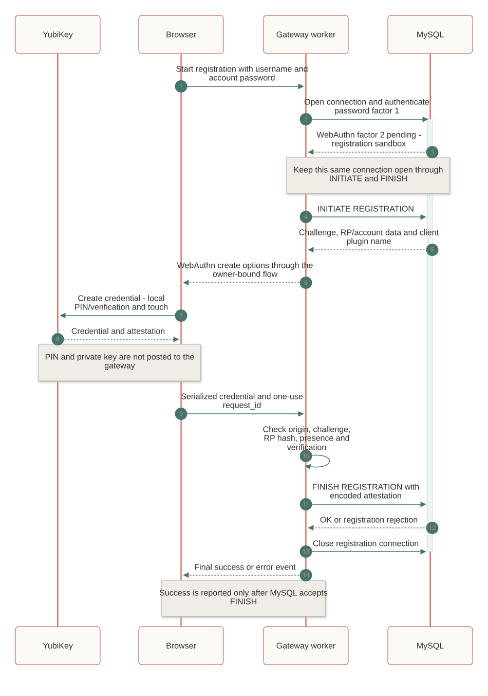
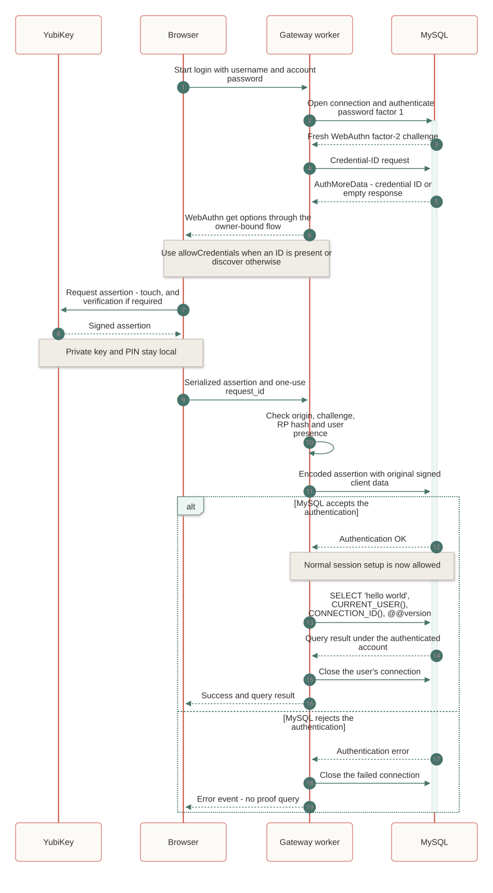

# MySQL browser gateway user manual

## Overview

The gateway connects a user's browser to MySQL's existing `authentication_webauthn` authentication plugin. The user enters their MySQL account password, then uses a YubiKey attached to their own computer. The browser manages the key interaction; the gateway relays the challenge and response; MySQL accepts or rejects the authentication.

The repository contains a reusable Python package and a Flask reference application. The application provides server setup, account creation, key registration, and login followed by a `hello world` query. It does not maintain a separate application passkey database or authenticate users through a shared database account.



[Component diagram source](diagrams/components.mmd)

The browser and YubiKey are on the user's computer. The gateway service includes the browser-facing HTTPS endpoint, Flask application, and per-user database adapter. Its internal loopback HTTP connection does not change the signed browser origin. Broker/Flow belongs to the gateway process; it is not a separate network service.

The package is an experimental interoperability prototype. A passing simulator test does not establish compatibility with a particular MySQL server, browser, or hardware key. See [limitations](#limitations) before selecting a deployment profile.

## Requirements

| Component | Requirement |
| --- | --- |
| Python | Python 3.10 or later, as declared by the package |
| Connector | Exactly `mysql-connector-python==26.10.0`; the package checks this at construction time |
| CBOR library | `cbor2==5.9.0` |
| Reference web application | `Flask==3.1.3` |
| Test dependencies | `cryptography>=44` in addition to the application dependencies |
| MySQL | A server with the Enterprise `authentication_webauthn` plugin available and ACTIVE, and a policy permitting the password/WebAuthn chain |
| Test account | Password factor 1 and WebAuthn factor 2; the demonstrated password plugin is `caching_sha2_password` |
| Browser | WebAuthn support, JavaScript, cookies, and a trusted secure context matching the configured origin |
| Hardware | A compatible external FIDO2 key supporting discoverable credentials and local user verification; a physical YubiKey is the intended device |
| Attestation | Packed ES256 attestation containing an X.509 certificate (`x5c`); the browser must actually return this format |
| Browser endpoint | Current implementation: `BROWSER_ORIGIN=https://RP_ID`, using HTTPS port 443 |
| Database transport | Verified TLS for a remote database, or the explicit development exception for a loopback database |
| Local launcher | Bash, an existing `.venv`, and Caddy available on `PATH`; trust its local CA in the browser/OS |

The Python gateway machine needs neither an attached YubiKey nor the `mysql` command-line executable. A DBA may use the CLI separately to administer the database. Native MySQL client availability is not a gateway runtime requirement.

### Current HTTP and HTTPS behavior

General WebAuthn permits an HTTP-localhost exception to its secure-context requirement. This repository intentionally implements a narrower origin profile: both `create_app()` and `Gateway()` require `https://` followed by the RP ID, with no custom port. Browser-signed client data must match that exact origin.

Consequently, `http://localhost:5001` is not a supported registration/login origin in the current app. Flask listens internally on port 5001, and the local launcher configures HTTPS in front of it. The HTTP-only diagrams in the internal presentation describe a simplified design option; they did not change the application or launcher. Remote browser WebAuthn requires HTTPS. See [configuration](configuration.md#origin-and-hostnames).

## How it works

### Components and responsibilities

| Component | Responsibility |
| --- | --- |
| Browser | Calls WebAuthn, presents key prompts, serializes the returned credential, and participates in its own flow |
| YubiKey | Performs local verification and signing; private key material stays on the authenticator |
| Flask application | Checks Origin, CSRF, administrator authorization, input shape, and flow ownership; runs database work in a worker |
| `Broker` and `Flow` | Connect the worker to one browser session using expiring events and one-use response tokens |
| `Gateway` | Adapts Connector/Python authentication to browser WebAuthn without changing signed client data |
| MySQL | Selects the account, checks factors and proof, stores account authentication information, and enforces SQL grants |

The gateway receives the MySQL password to complete the password factor, so it is a trusted component. The YubiKey PIN and private key are not application inputs and are never posted to Flask.

### Registration sequence



[Registration diagram source](diagrams/registration.mmd)

The worker uses `ask('create', options)` to pause database work while the owner-bound browser flow completes `navigator.credentials.create()`. It preserves the signed browser bytes, checks the supported attestation shape, and submits the proof on the **same MySQL connection** that issued the challenge. MySQL must return OK before success is reported.

`SET NAMES`, autocommit initialization, pings, and business SQL must not be inserted into the pending-registration connection. The dedicated reader accepts INITIATE results with or without a metadata EOF separator.

### Login sequence



[Login diagram source](diagrams/login.mmd)

The adapter removes the MySQL packet header and `AuthMoreData` tag before parsing the credential-ID response. If MySQL supplies an ID, browser options include `allowCredentials`; otherwise the browser uses discoverable-credential lookup. `ask('get', options)` waits for the browser's `navigator.credentials.get()` response. Only after MySQL accepts the assertion may the application run its proof query on the authenticated connection.

The demo proof query is:

```sql
SELECT 'hello world', CURRENT_USER(), CONNECTION_ID(), @@version;
```

The result identifies the accepted MySQL account and connection. The app does not switch to a shared database connection after a successful browser gesture.

### Why login may still ask for a PIN

Registration requests `userVerification='required'`. Login requests `userVerification='discouraged'` and requires user presence. A supplied credential ID can avoid discovery, but the browser, key policy, or discoverable-credential lookup can still require verification. Registration is not a permanent PIN unlock for all later requests. [Yubico explains the distinction between presence and verification](https://developers.yubico.com/WebAuthn/WebAuthn_Developer_Guide/User_Presence_vs_User_Verification.html).

## Install and start the local reference application

Run from the repository root:

```bash
python3 -m venv .venv
.venv/bin/python -m pip install -r requirements.txt
cp config.example.env .env
./start.sh
```

Review `.env` before running: the launcher sources it as shell code. Do not put real secrets into `config.example.env` or commit `.env`.

The current local launcher:

- Uses `.venv/bin/python` without requiring virtual-environment activation.
- Sets `RP_ID=localhost` and `BROWSER_ORIGIN=https://localhost`, overriding remote example values in the shell or `.env`.
- Defaults the database to `127.0.0.1:5316` and permits the documented loopback database exception when no CA or explicit override is set.
- Generates an administrator token when it is unset for the local origin, and prints the configured/generated token. An explicitly empty token disables administrator actions.
- Reloads or starts Caddy with `Caddyfile.local`, forwarding HTTPS to Flask at `127.0.0.1:5001`.

Open **https://localhost** in the browser. Trust the local CA through the OS/browser trust mechanism; do not depend on bypassing certificate warnings. Stop Flask using **Ctrl+C**. Stopping Flask does not stop the separately running HTTPS proxy or MySQL.

Running `python app.py` directly reads exported environment values, not `.env`, and does not generate an administrator token or configure the HTTPS listener. It still requires a valid database transport configuration at application construction.

## Prepare the server and account

### Server setup banner

Enter the administrator token printed by the launcher and the MySQL root password in the top setup banner. Click **Sign in as root & apply settings**.

The worker checks that the WebAuthn plugin is ACTIVE, sets the persistent MySQL RP ID to the application's `RP_ID`, and persists `connect_timeout=max(180, current_value)`. It then reads the values back. Provisioning requires a matching RP ID and a timeout of at least 150 seconds; setup normally gives at least 180 seconds.

Changing the global RP ID can invalidate existing registrations. Setup uses separate statements and may be partially applied if a later statement fails. Coordinate changes on a shared database.

Equivalent administrator SQL for the localhost example is:

```sql
SHOW PLUGINS;
SHOW GLOBAL VARIABLES LIKE 'authentication_policy';
SET PERSIST authentication_webauthn_rp_id = 'localhost';
SET PERSIST connect_timeout = 180;
```

The administrator must have the privileges needed for the operations. Setup does not install the plugin or change `authentication_policy`.

### Create database user

In the first column, enter:

| Field | Value to supply |
| --- | --- |
| Administrator token | The app's configured token, not a MySQL password |
| MySQL root password | Root's database password, used for this action only |
| New username | A `demo_` account name using 1–32 ASCII letters, digits, or underscores |
| New user password | The password that this account will use in Register and Login |
| Drop existing account | Leave unchecked to preserve an existing account; check only when intentionally replacing the demo account |

The SQL template is:

```sql
CREATE USER 'demo_fido'@'localhost'
  IDENTIFIED WITH caching_sha2_password BY '<unique-new-user-password>'
  AND IDENTIFIED WITH authentication_webauthn;
```

The account host must match the **gateway source as MySQL sees it**, not the remote browser. Configure `DB_ACCOUNT_HOST` accordingly. Only the reference create form imposes the `demo_` prefix; the reusable gateway does not provision accounts.

Dropping an account removes its grants and server-side registration. Passkeys can remain on the YubiKey and require separate removal. If recreation fails after a drop, the old account remains removed; the app reports this condition.

### Register the YubiKey

In **Register your YubiKey**, enter the created username and its **new user password**. Use neither the root password nor the administrator token. Insert the key into the browser computer and click **Register in browser**. Complete the browser's local PIN/touch/attestation prompts.

Success means MySQL accepted FINISH REGISTRATION. If the browser created a passkey but MySQL rejected the proof, that passkey may still exist on the key. Do not assume the database enrolled it.

An already registered account is not silently overwritten by this adapter. Coordinate replacement/unregistration with a DBA. The demo has no key-management or recovery screen.

### Login and execute hello world

Enter the same account username/password in the Login column and click **Authenticate to MySQL**. Complete the key gesture and any browser/key verification prompt. A successful result includes `message`, `mysql_account`, `connection_id`, `server_version`, and `verified_by`.

The `hello world` literal query needs no table privileges. A new application's business queries do need the appropriate grants.

### Read the activity banner

Each valid form submission updates the activity banner, shows submitted SQL templates, and finishes with success or error. Passwords and credential responses are redacted; `%s` marks parameters not displayed. MySQL authentication uses protocol messages, so there is no SQL `LOGIN` statement to show.

A displayed command is an execution attempt, not proof of acceptance. A `202` HTTP response only means the operation was accepted for processing. A worker error is returned as a flow event, often in an HTTP `200` poll response. Only a `success` event indicates completion.

## Use a remote browser or database

Choose the public RP hostname before enrolling keys, for example `fido.example.com`. Set both app variables to the corresponding values, and align MySQL's global RP ID:

```bash
export RP_ID=fido.example.com
export BROWSER_ORIGIN=https://fido.example.com
export DB_HOST=mysql.example.com
export DB_SSL_CA=/secure/mysql-ca.pem
unset ALLOW_LOOPBACK_DB_PLAINTEXT
./start.sh --remote
```

`--remote` honors the configured RP/origin but does not set up the public HTTPS listener. Configure your existing HTTPS service, or adapt `Caddyfile.remote` to your hostname and run it separately. The reference Flask process still binds only to `127.0.0.1:5001`. Select a production WSGI deployment and administrator access controls before exposing a real service.

Use a database hostname matching its database TLS certificate. Browser HTTPS and database TLS are independent. See the complete [configuration reference](configuration.md) and [new application guide](new-application.md).

## Troubleshooting

| Symptom | Check |
| --- | --- |
| Local/remote MySQL requires TLS settings | Use a valid CA and verification, or explicitly allow the loopback development exception for a local DB |
| HTTP 400 and an untrusted host | Open the configured browser hostname; a local request through the loopback backend redirects to the configured HTTPS origin |
| Port 5001 is already occupied | Stop the existing Flask instance before restarting; the reference application has no port environment variable |
| Plugin is not ACTIVE | Have the DBA install/enable the server plugin; the app does not install it |
| RP mismatch | Align browser URL, app RP/origin, and MySQL RP ID; do not rewrite signed browser data |
| Administrator actions disabled | Start with a nonempty `ADMIN_TOKEN`; refresh the page after restarting |
| HTTP 403 | Check Origin, CSRF token, session cookie, and administrator token where applicable; reload after a restart |
| MySQL 1045 before SQL | Check the end-user password, matched account host, and authentication configuration; use root credentials only for setup/create |
| Connector error `-1` | Read the reported connector class/detail and stage; it is not a specific server error number or proof of a wrong password |
| Truncated/malformed credential-ID response | Check adapter/server compatibility and AuthMoreData framing; do not bypass the parser or fabricate an ID |
| Packed ES256/x5c error | The browser did not return supported attestation; requesting direct attestation does not force its release |
| No browser key dialog | Check trusted HTTPS, WebAuthn support, account registration state, and the event returned in the banner |
| Ceremony expired / wrong request token | Start a fresh flow, finish within the deadline, and do not reuse a prior response |
| Gateway busy | Wait for current/recent flows to expire; capacity includes finished flows until expiration cleanup |
| SQL fails after successful authentication | Verify the authenticated account's grants and business query; do not substitute a shared account |

The application logs error number, exception class, action, and stage without dumping connector SQL or passwords. Read the MySQL server error log when needed; avoid collecting PINs, passwords, tokens, or full credential responses in diagnostics.

## Limitations

- The browser profile is intentionally narrower than general WebAuthn: exact HTTPS host match on port 443. HTTP localhost and custom browser ports are not implemented.
- The supported ceremony is password factor 1 followed by WebAuthn factor 2. The demonstrated profile is an external discoverable FIDO2 credential with packed ES256/x5c attestation.
- Other attestation formats, self-attestation, legacy U2F enrollment, and browser-suppressed certificate attestation are rejected. A compatible non-Yubico authenticator can satisfy this profile; the adapter does not independently enforce manufacturer identity.
- PIN-free login is a request, not a guarantee. Discovery, browser behavior, and key policy can still require a PIN.
- Connector/Python private APIs and special wire-format handling make version upgrades a compatibility exercise. Merely changing the version constant is not sufficient validation.
- The demo keeps flows in memory in one process. Restarting loses pending ceremonies; multiple independent WSGI workers cannot share these flows without an alternative transport/state design.
- The default broker allows 32 current/recent flows and one unfinished flow per owner. Flows expire after 150 seconds. Bounded queues require active polling; unconsumed or excessive events can fill them.
- No user connection pooling, durable session/credential storage, automatic reconnect, key recovery, or application-level authentication fallback is provided. Successful login closes the demo connection after its proof query; it does not establish a reusable database login session for later requests.
- The administrator token is a demo access gate, not a complete administrator identity system. Rate limiting, durable ceremony management, stronger operator authorization, monitoring, and production deployment controls need additional work.
- The automated tests use actual Connector/Python sockets with a protocol simulator and software authenticator. The suite includes both tutorial starters and session-isolation checks; it is not a physical-YubiKey or commercial-server certification.

## Validate a target deployment

Record the MySQL version, plugin state, RP ID, timeout, Connector/Python version, browser/OS, and key model/firmware. Verify real registration and login, the returned `CURRENT_USER()`, wrong-password rejection, wrong-key rejection, cancellation, replay rejection, simultaneous-user isolation, and behavior after a restart.

For the repository tests:

```bash
.venv/bin/python -m pip install -r requirements-dev.txt
.venv/bin/python -m unittest discover -s tests -v
```

The older [validation record](../VALIDATION.md) is a dated snapshot, not the current test count. Technical definitions and primary specifications are collected in [terms and references](terms-and-references.md).
